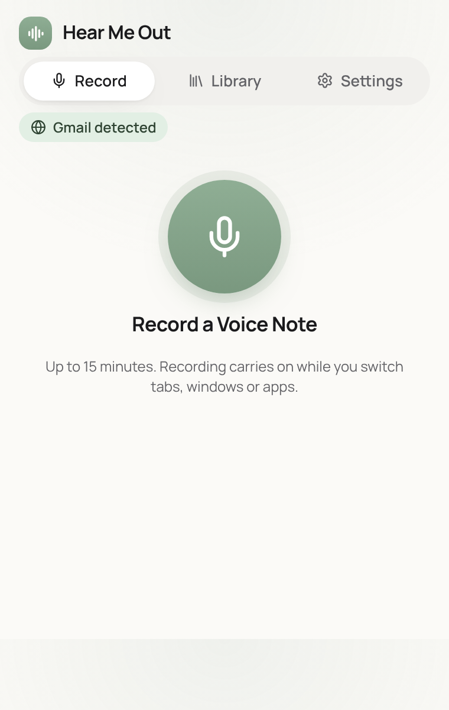
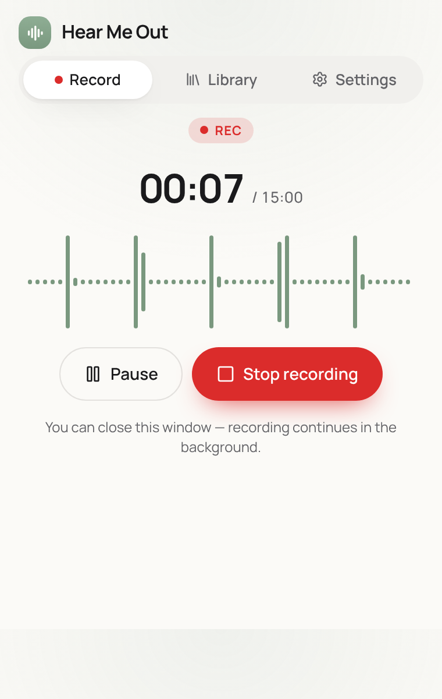
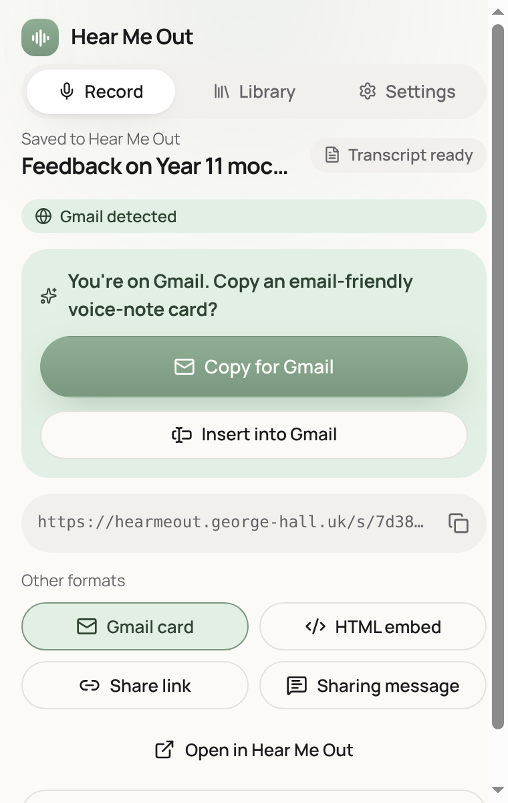
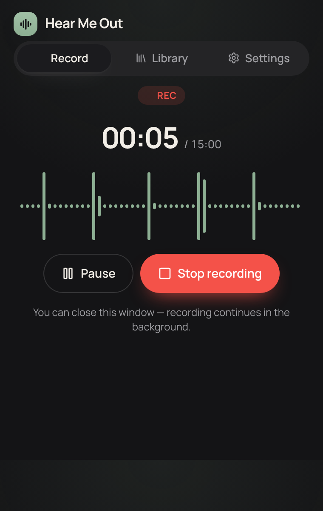

# Hear Me Out for Chrome

Record a voice note from any tab, keep working while it records, and copy it in the format that suits
the website you're on. That means an email card in Gmail or Outlook, an HTML embed in Moodle, and a
link anywhere else.

It's a Manifest V3 extension for **Google Chrome on Windows 11, macOS and Chromebooks**. It uses the existing Hear
Me Out service (`https://hearmeout.george-hall.uk`) and the media server
(`https://mediahub-lm-1.georgehalltuition.com`). It has no backend, database or audio hosting of its own.

<p>




</p>

## Quick start: install without building anything

**Recommended:** publish it to the Chrome Web Store as **Unlisted** (once, about 30 minutes, with
copy-paste answers in [`store/README.md`](store/README.md)). After that, every computer is just
*open link → Add to Chrome*. There's no Developer mode, it updates itself, and it works on most
work machines.

**Available now, as the fallback:**

**→ [Step-by-step install guide for Windows 11, macOS and Chromebook, with screenshots](docs/INSTALL.md)**

In short:

1. Download [`download/HearMeOut-for-Chrome.zip`](download/HearMeOut-for-Chrome.zip) and unzip it
   somewhere permanent.
2. Go to `chrome://extensions`, turn on **Developer mode**, click **Load unpacked**, and choose the
   `HearMeOut-for-Chrome` folder.
3. Click the icon, then **Sign in with Google**. You only do this once per Chrome profile, and you
   stay signed in.

The rest of this README is the technical reference.

---

## Contents

1. [Build from source](#build-from-source)
2. [One-off backend step](#one-off-backend-step)
3. [Using it](#using-it)
4. [How background recording works](#how-background-recording-works)
5. [Website detection and sharing](#website-detection-and-sharing)
6. [Keyboard shortcuts](#keyboard-shortcuts)
7. [Authentication and Chrome profiles](#authentication-and-chrome-profiles)
8. [Permissions, privacy and security](#permissions-privacy-and-security)
9. [Testing](#testing)
10. [Project layout](#project-layout)
11. [Chrome Web Store preparation](#chrome-web-store-preparation)
12. [Troubleshooting](#troubleshooting)

---

## Build from source

You only need this to change the code. To install the extension, use
[`download/HearMeOut-for-Chrome.zip`](download/HearMeOut-for-Chrome.zip) and the
[install guide](docs/INSTALL.md).

Requirements: Node.js 22 or later, and npm. You need these only to build. The built extension has no
runtime dependencies and needs no local server.

```bash
npm ci
```

```bash
npm run build
```

The build goes into `dist/`. Then, on each Chrome profile you want to use:

1. Go to `chrome://extensions`.
2. Turn on **Developer mode** (top right).
3. Click **Load unpacked** and choose the `dist` folder.
4. Pin **Hear Me Out** from the puzzle-piece menu so the REC indicator is always visible.

After changing code, run `npm run package:download` to refresh the downloadable zip, and
`npm run screenshots` (on Linux: `xvfb-run -a npm run screenshots`) to refresh `docs/screenshots/`.

The manifest contains a public `key`, so the extension ID is always
**`lphpbndpbbdgoglbgglgeckecbeilpjn`** in every profile and on every computer. That's the ID the
backend allow-list uses. After you rebuild, click the reload icon on the extension's card in
`chrome://extensions`.

## One-off backend step

Extension sign-in needs a small addition to the Hear Me Out app: an approval page and a step that
issues this profile's key. Paste [`backend/LOVABLE-PROMPT.md`](backend/LOVABLE-PROMPT.md) into
Lovable (or `git apply backend/hearmeout-extension-auth.patch`). It needs no database changes and no
new secrets, but set the non-secret `HMO_EXTENSION_IDS=lphpbndpbbdgoglbgglgeckecbeilpjn`. Until it's deployed, **Sign in with Google**
will show a "page not found" in the sign-in window.

## Using it

**First run, once per Chrome profile**

1. Click the toolbar icon, then **Sign in with Google**. A Hear Me Out window opens. If you're
   already signed in to the web app in this profile, just click **Connect this Chrome profile**.
   Otherwise Google's account chooser appears. Only the three authorised accounts are accepted.
2. Click **Record a Voice Note**. The first time, a tab asks for microphone access. Choose
   **Allow**, then **Start recording now**. Chrome won't ask again.

**Every day**

1. Click the icon, then the record button. The toolbar icon shows a red **REC** badge.
2. Carry on working. You can close the popup, switch tabs or windows, minimise Chrome, or use Word
   or Excel. Recording continues.
3. Open the popup again. The timer shows the real elapsed time. Click **Stop recording**.
4. Listen back, edit the title if you like (the default is something like *20 November 2026, 14:35*),
   then click **Save voice note**. It uploads directly to the media server and is finalised in Hear
   Me Out.
5. The share screen highlights the best format for the current site. Click it, then paste.

You can **Pause** and **Resume** while recording. **Record again** and **Discard** both ask before
deleting anything. Recordings stop automatically at **15:00**, even if the popup is closed. The
audio is kept for review, and a notification tells you it stopped.

## How background recording works

```
┌──────────── Popup (temporary UI) ────────────┐
│ Shows state, timer, waveform; sends commands │──┐  closes whenever you click away;
└──────────────────────────────────────────────┘  │  owns no microphone, no MediaRecorder
                                                  ▼
┌──────── Service worker (orchestration) ──────┐      chrome.storage.session  ◀─ shared state
│ start/pause/stop, badge, alarms, shortcuts,  │─────▶ (idle · recording · paused · stopped ·
│ auth, API calls, upload state machine        │       saving · uploading · completed · error)
└──────────────────────────────────────────────┘
                 │ messages (the worker may sleep at any time; nothing depends on it)
                 ▼
┌──────── Offscreen document (recording engine) ┐     IndexedDB (extension origin)
│ getUserMedia → MediaRecorder (WebM/Opus,       │────▶ drafts: timing + upload stage
│ 128 kbps). 15-minute limit enforced here.      │────▶ chunks: every 1-second chunk, as recorded
│ Direct PUT upload to the media server.         │
└────────────────────────────────────────────────┘
```

* **The offscreen document owns the microphone.** Chrome keeps it alive independently of the popup
  and the service worker. It isn't throttled when Chrome is in the background or minimised.
* **Every second of audio is written to IndexedDB as it's recorded.** If the recording engine dies
  unexpectedly, you lose at most about a second. The next time you open the popup, it shows the
  recording as *recovered*, ready to review and save.
* **Elapsed time comes from recorded timestamps**, not a popup timer. Reopening the popup always
  shows the right value, and pauses are excluded.
* **Only one recording can run at a time.** Chrome allows only one offscreen document per
  extension, and the worker also refuses a second start.
* **REC can't be misleading.** The state lives in `chrome.storage.session`, which Chrome clears when
  it exits. On startup the badge is cleared. Whenever the popup opens, the worker checks that the
  engine really is running and recovers the audio if it isn't.
* **The 15-minute limit** is enforced inside the engine by a timer and by a check on every chunk.
  A `chrome.alarms` alarm in the worker acts as a backstop.
* **The audio is never re-encoded.** The uploaded file is the exact WebM/Opus bytes Chrome produced.

**What it can't do.** Recording stops if Chrome quits completely, if the computer sleeps, or if the
operating system takes away Chrome's microphone access. In the last case the engine stops cleanly
and keeps everything captured so far.

### Saving and retrying

Saving is a resumable state machine stored on the draft:
`none → authorised → uploaded → finalised`.

1. `POST /api/public/v1/uploads` returns **201** with `uploadUrl` and the storage `headers`.
2. A `PUT` of the original bytes goes straight to the media server. Success is **201** (200 is also
   accepted), with progress shown.
3. `POST /api/public/v1/recordings/:id/finalize` with `transcribe:false` returns the share URL,
   embed URL and embed code straight away.
4. A second `finalize` with `transcribe:true` hands over to Hear Me Out's own transcription. You
   don't wait for it, and the transcript status appears in the Library.

If the `PUT` fails, the audio stays in IndexedDB and **Retry upload** resumes from the stage it
reached. If the storage token has expired, the extension asks for a fresh one **for the same
recording**, so retrying never creates a duplicate. A 403 is retried once automatically. Local audio
is deleted only after finalising succeeds.

## Website detection and sharing

When the popup opens, it reads the active tab's address (via `activeTab`) and matches it **locally**
against a central rules engine (`src/shared/rules.ts`). Addresses are never sent anywhere. While the
popup is open it re-checks on tab switches and in-page route changes, using events rather than
polling.

| Website | Recommended |
|---|---|
| Gmail (`mail.google.com`) | **Copy for Gmail**: rich email card |
| Moodle (`lms.georgehilltuition.com`, `lms.georgehalltuition.com`, configurable) | **Copy HTML Embed** |
| Outlook on the web | Rich email card ("Copy for Outlook") |
| Google Docs, Google Classroom, Slack, Microsoft Teams | Share link |
| Anything else | **Copy Share Link** |

In **Settings → Website detection** you can:

* add, edit and remove your own rules (hostname, `*.wildcard`, or `host/path*`, a friendly name and
  a preferred format). Your rules take priority over the built-in ones.
* edit the list of Moodle hosts;
* turn individual built-in rules off.

The recommendation is just the highlighted first button. All four formats are always available:

* **Copy for Gmail**: the same email-safe card as the web app's `gmailCardHtml()` (a linked
  `/api/public/card/:token` image, a "Listen" link, and the introduction). It's written as
  **`text/html` and `text/plain`** together. It never contains an iframe.
* **Copy HTML Embed**: the `embedCode` exactly as the API returned it, ready for Moodle's HTML
  source editor.
* **Copy Share Link**: the `/s/:token` listening page.
* **Copy Sharing Message**: "Hey, I've recorded you a voice memo. Click here to listen: [URL]"

**Insert into Gmail** is optional. It appears only when you're on Gmail. It's injected only when you
click it, using `chrome.scripting` and `activeTab`. It inserts the card at your cursor, or at the end
of the email if your cursor isn't in it. It only goes into a visible compose box, never replaces text
and never sends anything. If more than one compose window is open and none has focus, it asks you to
click into one. Direct insertion into Moodle isn't offered because editors and sanitisation vary
between sites. Use **Copy HTML Embed** and the HTML source view instead.

## Keyboard shortcuts

| Command | Default (Windows and Mac) |
|---|---|
| Open Hear Me Out (popup) | `Alt+Shift+H` (Mac: `⌥⇧H`) |
| Start/stop recording | `Alt+Shift+R` (Mac: `⌥⇧R`) |
| Copy latest voice note in the recommended format | `Alt+Shift+C` (Mac: `⌥⇧C`) |
| Open the Hear Me Out website | not set |

You can change these at **`chrome://extensions/shortcuts`**, or from **Settings → Keyboard shortcuts →
Change shortcuts**. That page also lets you make *Start/stop recording* **Global**, so it works while
Word or Excel is in front. Stopping with the shortcut opens the popup (where Chrome allows it) so you
can review and save.

## Authentication and Chrome profiles

* **Sign in with Google once per Chrome profile, then stay signed in.** Sign-in uses
  `chrome.identity.launchWebAuthFlow` to open the Hear Me Out web app's own Google sign-in, so its
  **account allow-list** stays in charge. When you approve, the server gives this profile its own
  **`hmo_` API key**. API keys don't expire and don't need refreshing, so Chrome restarts, laptop
  reboots and months of not using it won't sign you out. There's nothing to paste and no password
  prompt. See [`backend/README.md`](backend/README.md).
* **Only two things end the connection:** clicking **Sign out** in the extension (this revokes the
  key), or revoking it in **Hear Me Out → Settings → API keys**. Each key is listed there as
  "Chrome extension · <date>". Network failures and server errors never sign you out. If Hear Me Out
  ever rejects the key, the popup shows **Reconnect with Google** and keeps any unsaved recording.
* **Each Chrome profile is independent.** The key, settings, recordings, cached library and badges
  are all separate per profile. With three profiles open you get three independent extensions.
  There's no account switcher; to use another account, switch Chrome profile. On a new laptop you
  sign in once per profile again.
* **Sign out** revokes this profile's key on the server, then removes it, the library cache, the
  last share link and any unsaved recordings from this profile.

## Permissions, privacy and security

| Permission | Why |
|---|---|
| `offscreen` | Hosts the recording engine that survives the popup closing. |
| `storage` | Settings and the shared recording state. These are `local` and `session` only; `sync` is never used. |
| `unlimitedStorage` | Stops Chrome clearing the extension's stored sign-in or unsaved audio when the disk is under pressure. |
| `identity` | `launchWebAuthFlow` for Google sign-in. |
| `activeTab` | Reads the current tab's address when you open the popup or use a shortcut, for website detection. It also allows the optional Gmail insertion. |
| `scripting` | The optional **Insert into Gmail**, only when you click it. |
| `clipboardWrite` | Copying from the shortcut, which runs without the popup. |
| `alarms` | Backstop for the 15-minute limit. |
| `notifications` | "Limit reached", "Microphone disconnected", "Copied" and similar messages when the popup is closed. |
| Hosts | Only `hearmeout.george-hall.uk` and `mediahub-lm-1.georgehalltuition.com`. |

There are no content scripts, no `<all_urls>`, and no `tabs` or `history` permission.

* **Credentials** are kept in IndexedDB of the extension origin. Web pages and content scripts can't
  read it, it's never synced, and only the service worker uses it. They're never logged.
* **The media gateway secret and HMAC signing are not in the extension.** The extension receives
  only the per-file upload token that the Hear Me Out API issues. An automated check confirms this
  on every e2e run.
* No browsing history, page contents, Gmail messages or Moodle data are read or sent. There's no
  analytics or tracking.
* Audio stays on your computer only until it's saved. It's deleted locally once Hear Me Out confirms
  the upload, or when you discard it.

## Testing

```bash
npm test
```

This runs the unit tests (Vitest): the rules engine, sharing formats, timing and titles, IndexedDB
storage and recovery, the auth callback, token refresh, and API status handling.

```bash
npm run test:e2e
```

This is the end-to-end suite in real Chromium. On Linux without a display, run it as
`xvfb-run -a npm run test:e2e`. It uses a fake microphone and local mock servers that implement the
documented API and media endpoints. It covers sign-in, background recording (popup closed, tabs and
windows switched, window minimised, service worker terminated), decoded-audio length checks, a single
recording at a time, pause and resume, recovery after the engine is killed, upload failure and retry
without duplicates, the library, sign-out, two profiles at once, and the limit with the popup closed, and the
safety rules for **Insert into Gmail**.

`HMO_E2E_LONG_SECONDS=300` makes the main background recording last five minutes.

Testing in the real world on Chrome for **macOS** and **Windows 11** with Word or Excel in front
can't be automated here. Use the step-by-step checklist in
[`docs/MANUAL-TESTING.md`](docs/MANUAL-TESTING.md).

The backend patch has its own tests (`src/test/extension-auth.test.ts` in the app).

## Project layout

```
src/
  manifest      → scripts/manifest.mjs (generated into dist/manifest.json)
  background/   service worker: index (routing, shortcuts, lifecycle), recording (controller),
                pipeline (resumable upload), auth, api, state (session state + badge),
                offscreen-host (offscreen lifecycle), notify
  offscreen/    recording engine (recorder.ts), direct uploader, clipboard, live levels
  popup/        React UI: Record · Library · Settings, share panel, waveform, Gmail insertion
  permission/   one-off microphone permission page
  shared/       config, types, rules engine, sharing formats, IndexedDB, settings, timing, messages
public/         icons, level-meter AudioWorklet
backend/        patch and notes for the Hear Me Out app (sign-in support)
tests/unit/     Vitest unit tests
tests/e2e/      Playwright scenario runner and mock servers
docs/           manual test plan
```

## Chrome Web Store preparation

```bash
npm run package
```

This produces `store/hearmeout-chrome-<version>.zip` **without** the manifest `key`, because the
store assigns its own ID. Nothing is uploaded. Publishing is your decision. If you publish, add the
store's extension ID to `HMO_EXTENSION_IDS`. The store listing will need a privacy policy that
reflects the [Permissions, privacy and security](#permissions-privacy-and-security) section.

## Troubleshooting

* **"Microphone blocked"**: open the permission tab (Settings → Microphone → *Allow microphone*)
  and allow it. On macOS, check *System Settings → Privacy & Security → Microphone → Google
  Chrome*. On Windows 11, check *Settings → Privacy & security → Microphone* and turn on *Let
  desktop apps access your microphone*. On a Chromebook, check *Settings → Security and privacy →
  Privacy controls → Microphone access*.
* **Sign-in window says page not found**: the backend patch isn't deployed yet.
* **"That Google account isn't authorised"**: only the allow-listed accounts can use Hear Me Out.
* **Upload failed**: the recording is safe. Click **Retry upload**. Persistent 5xx errors come from
  the media server.
