# Install Hear Me Out for Chrome

Step-by-step instructions for **Windows 11**, **macOS** and **Chromebooks**. It takes about five
minutes per computer, and you only do it once.

You don't need to install anything else: no Node.js and no developer tools. You download one zip
file, unzip it, and point Chrome at the folder.

> **Before you start (one time only):** make sure the Hear Me Out website has the extension
> sign-in update. In Lovable, click **Publish → Update** if you haven't since applying the change.
> To check, open <https://hearmeout.george-hall.uk/extension/connect> in Chrome. You should see a
> Hear Me Out card saying *"This link is incomplete…"*. If you see "Not found", the update isn't
> live yet.

---

## Step 1: Download

Download **[`download/HearMeOut-for-Chrome.zip`](../download/HearMeOut-for-Chrome.zip)** from this
repository. On GitHub, open the file and click the **Download raw file** button (⤓) at the top
right.

> On GitHub, check the branch selector at the top left shows the branch the extension was delivered
> on (for example `claude/focused-sagan-vmf8v9`), or `main` once it's merged.

## Step 2: Unzip it somewhere permanent

Chrome runs the extension **from this folder**, so put it somewhere you won't tidy away. If you
delete or move the folder later, the extension stops working.

<strong>Windows 11</strong>

1. Open **File Explorer → Downloads**.
2. Right-click **HearMeOut-for-Chrome.zip** and choose **Extract All…**.
3. Change the destination to your **Documents** folder (for example
   `C:\Users\<you>\Documents`) and click **Extract**.
4. You now have `Documents\HearMeOut-for-Chrome`, which contains `manifest.json`, `popup.html` and
   an `icons` folder.

<strong>macOS</strong>

1. In **Finder → Downloads**, double-click **HearMeOut-for-Chrome.zip**. macOS unzips it
   automatically. (Safari may already have done this for you.)
2. Drag the **HearMeOut-for-Chrome** folder into **Documents**.
3. Inside it you should see `manifest.json`, `popup.html` and an `icons` folder.

<strong>Chromebook (ChromeOS)</strong>

1. Open the **Files** app and go to **Downloads**.
2. Right-click **HearMeOut-for-Chrome.zip** and choose **Extract all**. The folder appears next to
   the zip.
   * On older ChromeOS versions without **Extract all**, double-click the zip to open it. It appears
     in the left sidebar like a USB stick. Copy the **HearMeOut-for-Chrome** folder into **My
     files**, then eject the zip. **Don't** load the extension straight from inside the opened zip,
     because it disappears when the zip closes.
3. Optionally, move the folder from Downloads into **My files** so it isn't cleared out with old
   downloads.

You **don't** need Linux or Developer Mode for the whole Chromebook. Only Chrome's own extension
**Developer mode** switch, in the next step, is needed.

## Step 3: Load it into Chrome

Do this **in each Chrome profile** you want to use: personal, work, tutoring and so on. Each profile
signs in separately and keeps its own recordings.

1. In the address bar type **`chrome://extensions`** and press Enter.
2. Turn on **Developer mode** (top right).
3. Click **Load unpacked**.
4. Choose the **HearMeOut-for-Chrome** folder (the one containing `manifest.json`) and click
   **Select** / **Open**.

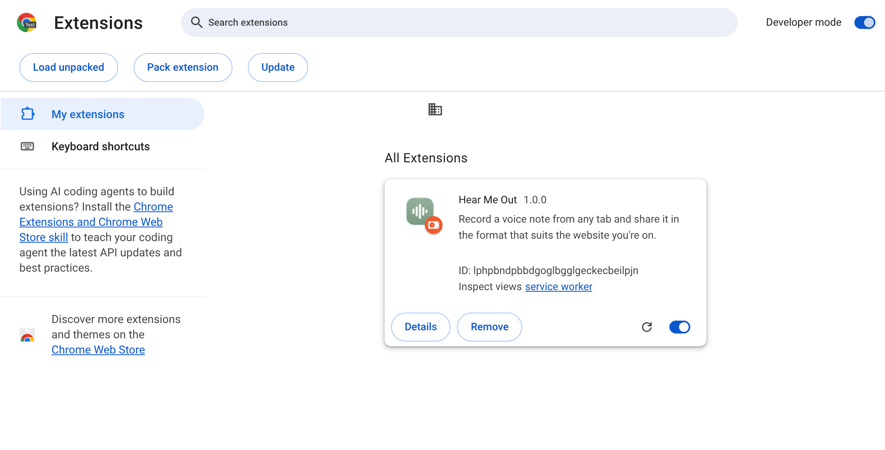

The card should say **Hear Me Out 1.0.0** with the ID **`lphpbndpbbdgoglbgglgeckecbeilpjn`**. If
the ID is different, you loaded a different folder, and sign-in will be refused.

5. **Pin it** so you can always see the **REC** indicator: click the puzzle-piece icon to the right
   of the address bar, then the pin next to **Hear Me Out**.

> **Managed Chromebooks and work computers:** if **Developer mode** or **Load unpacked** is greyed
> out, your organisation's IT policy blocks unpacked extensions. Personal Chromebooks and personal
> Macs and PCs aren't affected.

## Step 4: Sign in with Google (once per profile)

Click the Hear Me Out icon, then **Sign in with Google**.

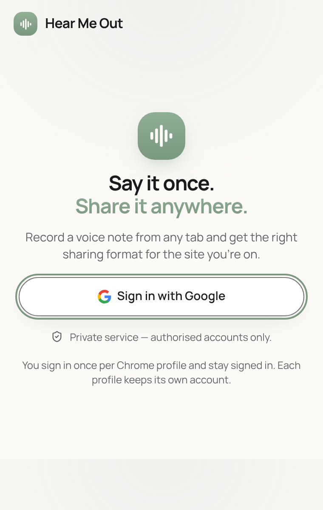

A Hear Me Out window opens:

* If you're already signed in to the Hear Me Out website in this profile, just click **Connect this
  Chrome profile**.
* Otherwise, Google's normal account chooser appears. Pick the right account for this profile. Only
  your three authorised accounts are accepted.

That's it. **You stay signed in permanently.** Restarts, updates and months of not using it don't
sign you out. Each connected profile appears in Hear Me Out → **Settings → API keys** as
"Chrome extension · <date>", and you can revoke it from there.

## Step 5: Allow the microphone (once)

The first time you press record, a tab opens asking for microphone access. Click **Allow
microphone**, choose **Allow** in Chrome's prompt, then **Start recording now**.

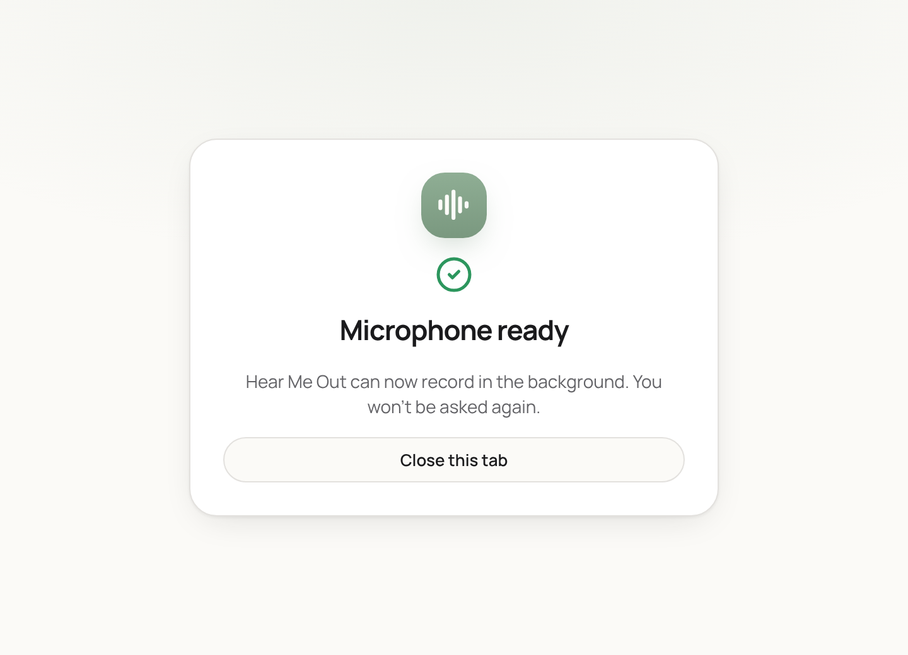

Your computer must also let Chrome use the microphone:

| | Where to check |
|---|---|
| **Windows 11** | **Settings → Privacy & security → Microphone**. Turn on *Microphone access*, *Let apps access your microphone* and **Let desktop apps access your microphone** (Chrome counts as a desktop app). |
| **macOS** | The first time, macOS asks *"Google Chrome would like to access the microphone"*; click **Allow**. To check later: **System Settings → Privacy & Security → Microphone → Google Chrome** on. If you change it, quit and reopen Chrome. |
| **Chromebook** | **Settings → Security and privacy → Privacy controls → Microphone access** on. Some Chromebooks also have a physical microphone-mute key or switch. |

---

## Everyday use

| | |
|---|---|
| 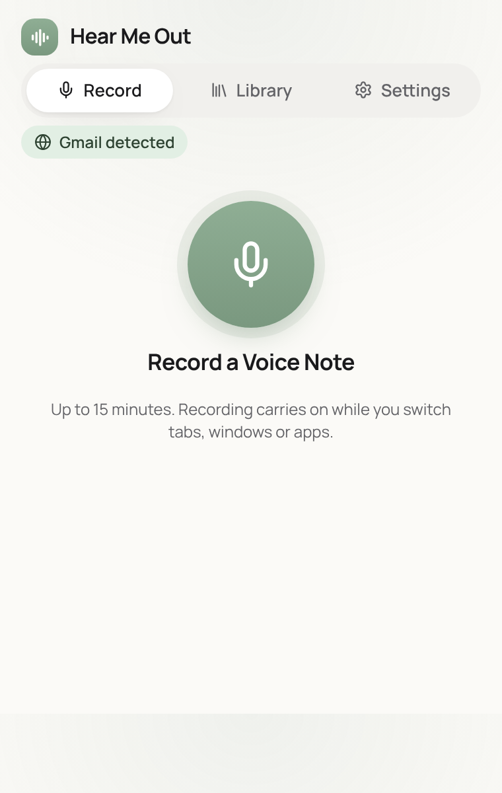 | **1. Record.** Click the icon, then the big button. The site you're on is detected (here, Gmail). |
| 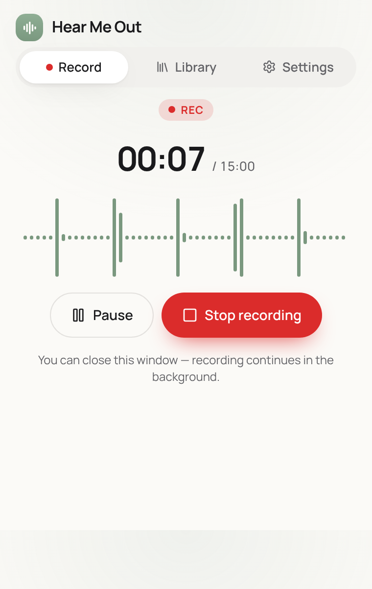 | **2. Keep working.** Click away and the popup closes, but recording carries on while you switch tabs, windows or apps. The toolbar icon shows a red **REC**. |
| 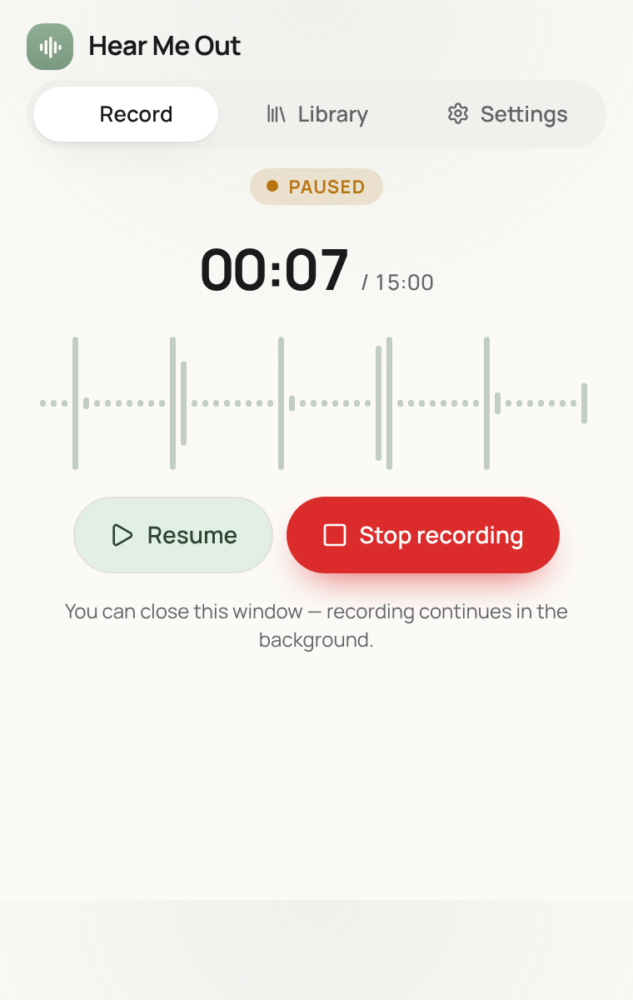 | **Pause / Resume** at any time. The paused time isn't recorded. |
| 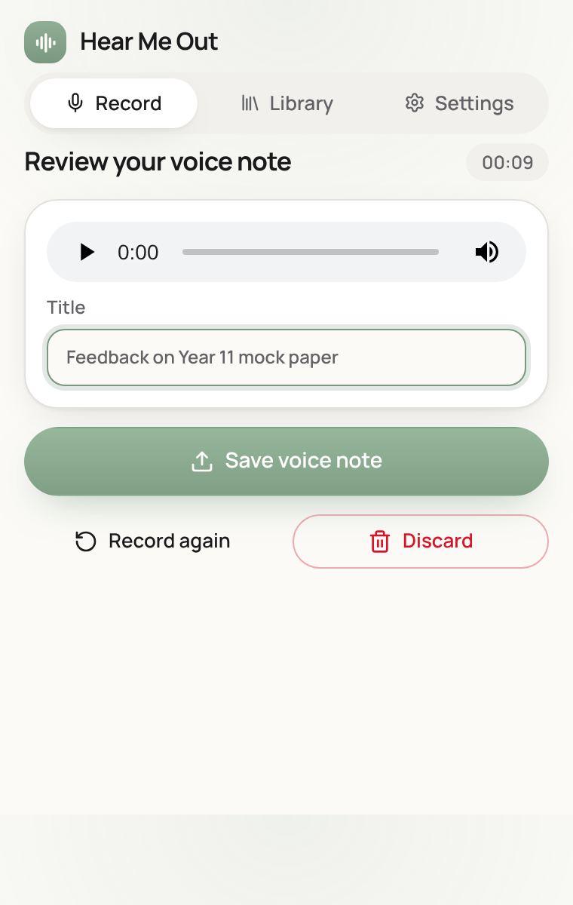 | **3. Stop and review.** Listen back, edit the title, then **Save voice note**. |
| 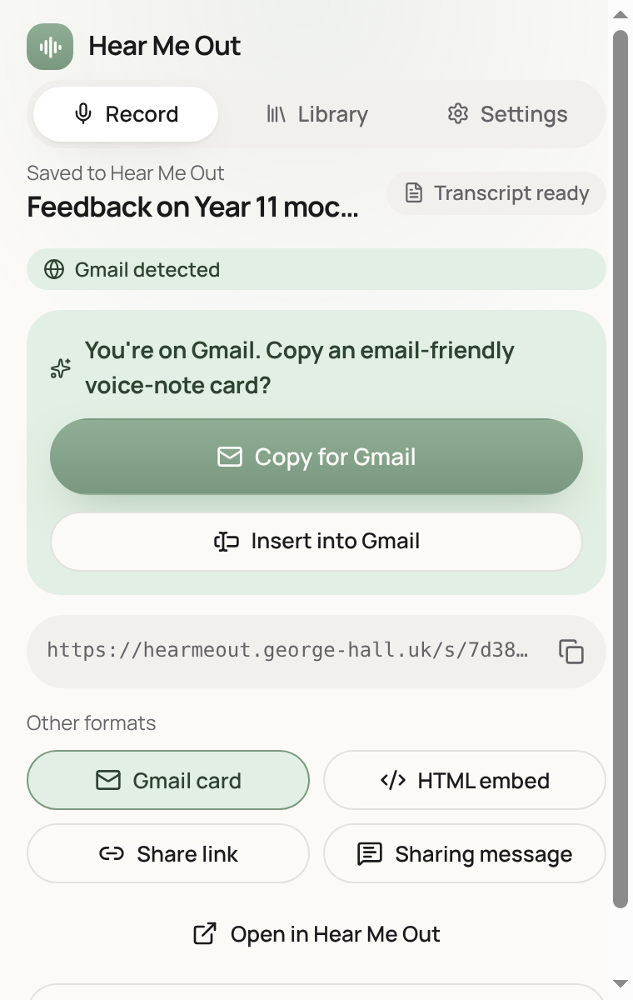 | **4. Share.** The best format for the site is highlighted. On Gmail it's **Copy for Gmail** (a clickable card); **Insert into Gmail** puts it straight into the email you're writing. |
| 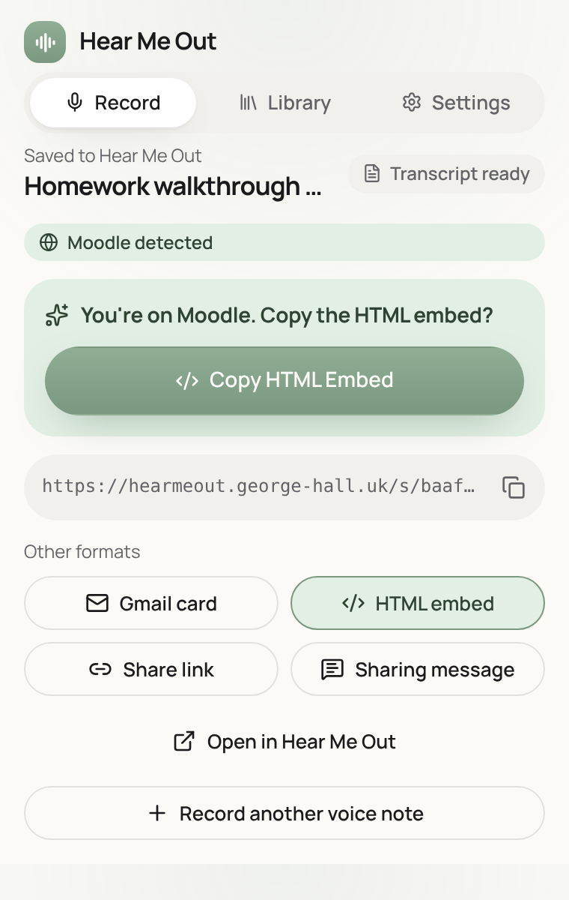 | On **Moodle** it recommends **Copy HTML Embed**. Paste it into the editor's HTML source view (the `</>` button). |
| 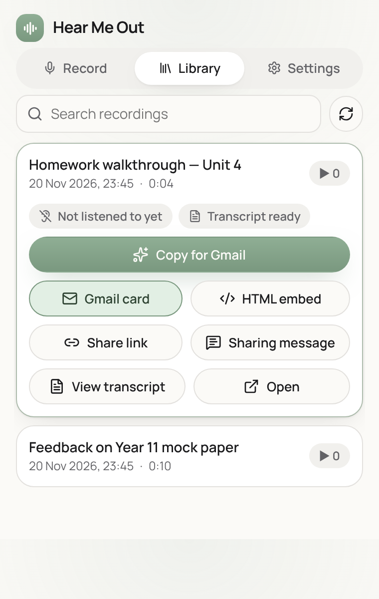 | **Library:** your recent recordings, play counts, transcripts and every copy format. |
| 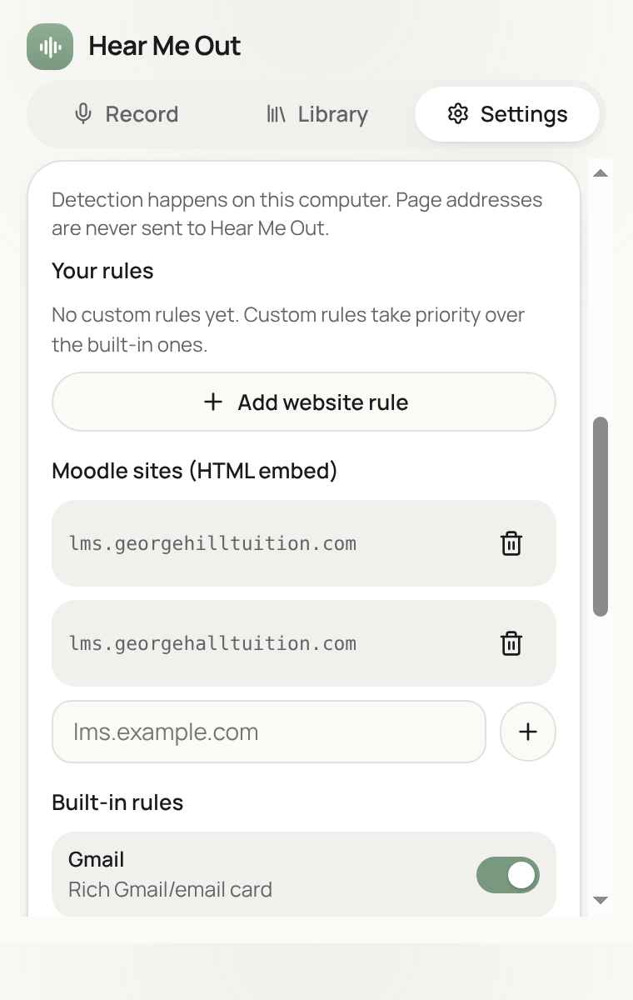 | **Settings:** appearance, microphone choice, your own website rules and Moodle sites. |

Light, dark or system theme:

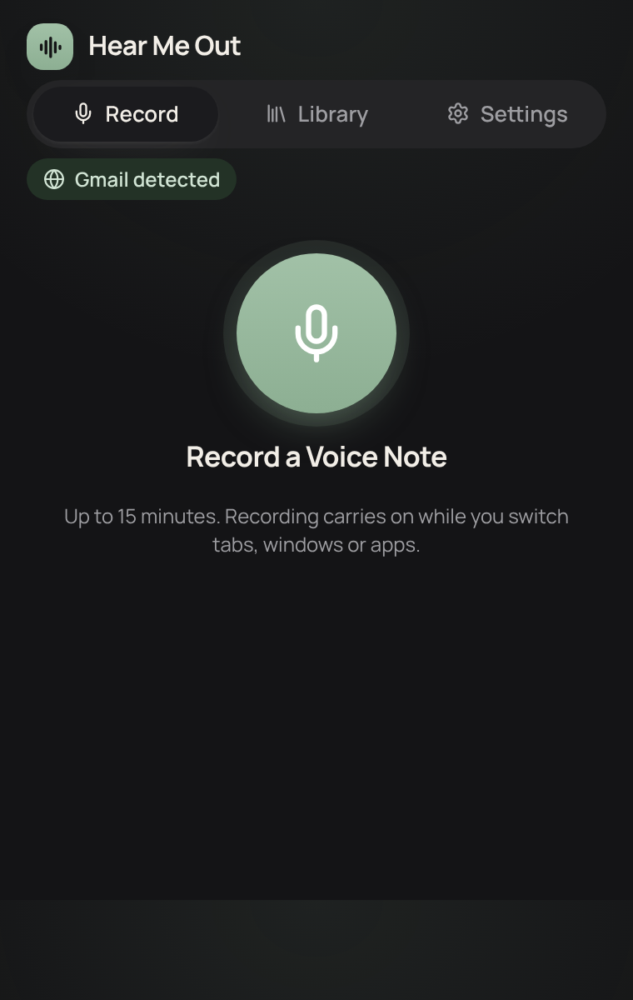 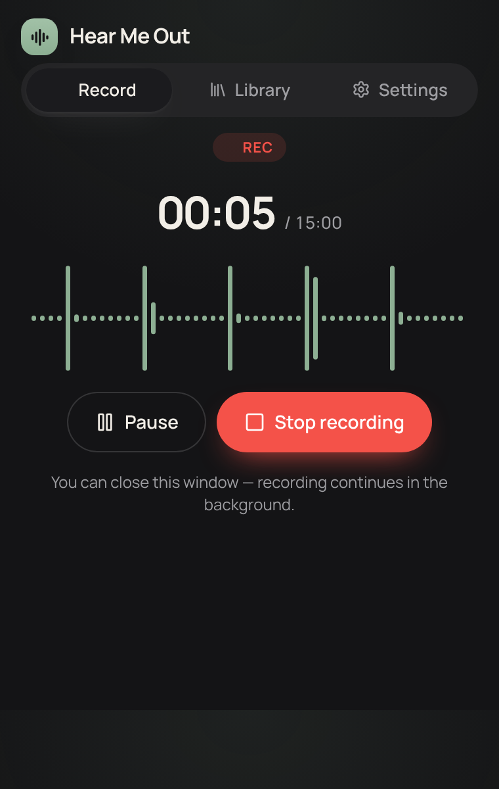

### Keyboard shortcuts

| Action | Windows / Chromebook | Mac |
|---|---|---|
| Open Hear Me Out | `Alt` + `Shift` + `H` | `⌥ Option` + `⇧ Shift` + `H` |
| Start / stop recording | `Alt` + `Shift` + `R` | `⌥ Option` + `⇧ Shift` + `R` |
| Copy latest voice note (best format for this site) | `Alt` + `Shift` + `C` | `⌥ Option` + `⇧ Shift` + `C` |

To change them, go to **`chrome://extensions/shortcuts`**. Set *Start/stop recording* to **Global**
there if you want it to work while Word or Excel is in front. Chromebooks don't offer Global; there,
shortcuts work while Chrome is the active window.

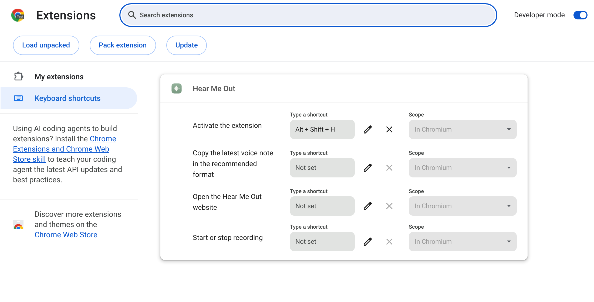

### What keeps a recording going, and what stops it

Recording **continues** when you close the popup, switch tabs, open other Chrome windows, minimise
Chrome, or use another app (Word, Excel, Teams and so on).

Recording **stops** if:

* you reach **15 minutes**. It stops automatically, keeps everything, and shows a notification.
* **Chrome quits completely**:
  * **Windows:** closing the *last* Chrome window quits Chrome. Keep at least one Chrome window
    open (minimising is fine).
  * **Mac:** closing windows is fine. Only **⌘Q** (Quit) stops Chrome.
  * **Chromebook:** Chrome only quits when you sign out or shut down.
* the computer **goes to sleep**, for example when you close a laptop lid.
* the microphone is unplugged, or the system turns microphone access off.

In each of these cases, the audio recorded up to that moment is kept. Next time you open Hear Me
Out, it offers the recovered recording for you to review and save.

---

## Updating to a new version

1. Download the new **HearMeOut-for-Chrome.zip** and unzip it **over the old folder**, replacing
   the files.
2. Go to `chrome://extensions` and click the **↻ reload** icon on the Hear Me Out card.

You stay signed in, and your settings are kept.

## Moving to a new laptop

Repeat steps 1–5 on the new computer, once for each Chrome profile. Afterwards, in Hear Me Out →
**Settings → API keys**, you can revoke the old laptop's "Chrome extension" keys.

## Troubleshooting

| Problem | Fix |
|---|---|
| Sign-in window says **Not found** | The website update isn't published. In Lovable, click **Publish → Update**. |
| "That Google account isn't authorised" | Choose one of your three allowed Google accounts. |
| **Reconnect with Google** banner | The key was revoked (or rejected). Click it and sign in again. |
| "Microphone blocked" | See the table in Step 5, then click **Allow microphone** again (Settings → Microphone). |
| Extension disappeared or shows an error after tidying files | The folder was moved or deleted. Unzip it again, then use **Load unpacked** (or ↻ reload). |
| Upload failed | Your recording is safe. Click **Retry upload**. |
| No **REC** badge visible | Pin the extension (Step 3, item 5). |
